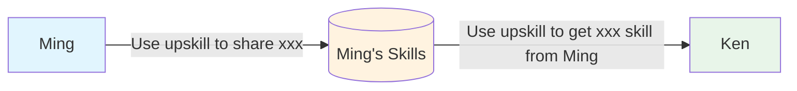
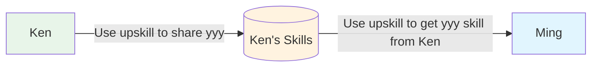

# Up Skill

Up skill **non-tech people** so that teams can make use of AI skills to improve their work experience.

## Goal

> Make Skills easy to share.
> Encourages you to build your **network** for **sharing skills** and equipt your teammates' superpower.

## To the Devs

> Your skills are **not useful** if they can't be shared

## Download

Go to the [latest release](https://github.com/mingzilla/upskill/releases/latest) and download the file for your computer.

| Computer | File |
|---|---|
| Windows | `Upskill_<version>_x64-setup.exe` |
| Mac, Apple Silicon (M1 and newer; Apple menu, About This Mac shows "Apple M…") | `Upskill_<version>_aarch64.dmg` |
| Mac, Intel (About This Mac shows "Intel") | `Upskill_<version>_x64.dmg` |
| Linux | `Upskill_<version>_amd64.AppImage` or `.deb` |

## Open it the first time

These builds are not code signed yet, so your computer warns you. This is expected.

| Computer | What to do |
|---|---|
| Windows | The blue "Windows protected your PC" window: click **More info**, then **Run anyway**. |
| Mac | Open the `.dmg` and drag Upskill to Applications. Open Terminal and run `xattr -cr /Applications/Upskill.app`, then open it. If it still says Apple cannot check it, try to open it once, then go to System Settings, Privacy & Security, scroll down and click **Open Anyway**. |
| Linux, AppImage | Right-click the file, Properties, allow running as a program, or run `chmod +x Upskill_*.AppImage`. Some systems also need `libfuse2`. |
| Linux, deb | `sudo apt install ./Upskill_*.deb` |

Still stuck? Open an issue with your computer, the file you downloaded, and the exact message or a screenshot.

## Set up

1. Type your GitHub username. Check the folder it suggests for your skills, then click **Apply**.
2. Click **Sign in**. Upskill shows a code and opens GitHub. Type the code there and approve.
3. Click **Setup**. Upskill creates three repos on your GitHub account and clones them into your folder:
   - `private_skills` is where your own skills live. Only skills here can be shared.
   - `public_skills` is for skills you share with anyone.
   - `skills_shared_with_network__default` is for skills you share with your network.

Linux: the sign-in is kept in the system keyring, which is cleared when you restart. You sign in again after a restart.

## Share and receive

- **Sharing**: pick where to share (a network, or public), then click **share** next to a skill. A skill that contains a password or key is marked red and cannot be shared.
- **Receiving**: pick a network, click **Refresh**, choose a person, and click **Get** next to one of their skills. It lands in your sandbox folder.
- **Copy**: hover a skill and click **copy**. Upskill puts the skill on your clipboard as a zip, so you can paste it into a chat window.

## Networks

A network is a named group of people. Everyone in a network must use the **same network name**, because that is how Upskill finds each person's repo (`skills_shared_with_network__<name>`).

1. On the Setup page, pick the network, type a GitHub username and a nickname, and click **Add**.
2. Click **Authorise All** to let the people in the network read your shared skills.
3. They click **Accept All** on their side. There is no GitHub page to visit.

To set up a whole team quickly: one person adds everyone, clicks **Export Network** and pastes the file into a chat. Everyone else drops that file on the network panel and confirms. It adds people and never removes anyone.

## Security

- Your GitHub token is kept in your computer's keychain, never in a file.
- Before a skill is shared, Upskill scans it for passwords and keys. Keep secrets in a `private_files` folder, which is never shared.
- Upskill does not run the skills it downloads. Read a skill before you use it.

## Feedback

Open an issue on this repo.
